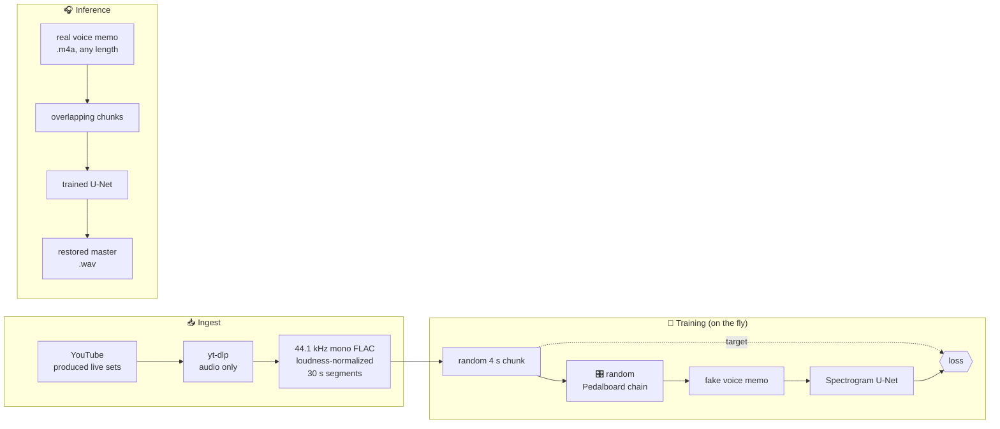
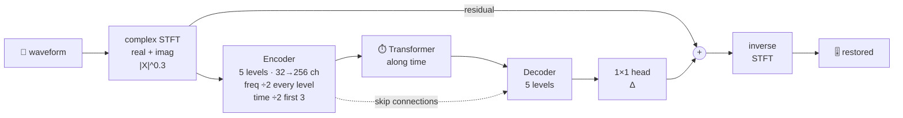

<div align="center">

# 🎙️ → 🎚️ memo2master

**Turn phone voice memos of live band sets into production-grade recordings.**

A spectrogram U-Net trained on professionally produced live recordings that were
*deliberately wrecked* to sound like they were captured on a phone in the back row.


[The idea](#-the-idea) •
[How it works](#-how-it-works) •
[Degradation chain](#-the-degradation-chain) •
[Model](#-the-model) •
[Quickstart](#-quickstart) •
[Roadmap](#-roadmap)

</div>

---

## 💡 The idea

In college I had hours of **voice memos** from my friends' bands playing live
contemporary Christian music (CCM) sets. They were recorded on phones, in
chapels and gyms, usually from the back of the room. The music was good. The
recordings were not.

There's no paired data for this problem. Nobody has a studio-quality version of
the same performance a phone happened to record. So this project **makes the
pairs itself**:

1. Take **clean**, professionally produced live recordings in the same style
   (shared with permission by my university's CCM band).
2. Run them through a **randomized degradation chain** that imitates everything
   a phone does to a live recording.
3. Train a model to map **degraded → clean**.
4. Point it at **real** voice memos and listen.

This repo is a from-scratch rebuild of my senior project, whose code was lost.
The original architecture is kept (Pedalboard degradation and a spectrogram
U-Net), along with the lessons learned since.

---

## 🔁 How it works



**Only clean audio is stored on disk.** Each chunk gets a fresh, randomly drawn
degradation every time it's loaded, so the model never sees the same damage
twice, and storage stays at 1× the clean corpus however long you train.

---

## 🎛️ The degradation chain

Everything between the stage and the phone's saved file is imitated in the order
it physically happens. Every stage fires with probability `p`, and every
parameter is sampled from a range in [`configs/degrade.yaml`](configs/degrade.yaml).

```mermaid
flowchart LR
    A[🎵 clean] --> B[🏛️ Room<br/>reverb / RIR]
    B --> C[📏 Distance<br/>EQ tilt]
    C --> D[👥 Noise<br/>crowd · HVAC · hum]
    D --> E[🎤 Phone mic<br/>high-pass + resonances]
    E --> F[📈 AGC<br/>gain breathing]
    F --> G[🗜️ Compressor<br/>+ Limiter]
    G --> H[💥 Clipping]
    H --> I[📉 Bandwidth<br/>resample 8–32 kHz]
    I --> J[💾 Codec<br/>MP3 / GSM]
    J --> K[📱 voice memo]
```



| Stage | Pedalboard / numpy | What it imitates |
|---|---|---|
| 🏛️ Room | `Convolution` with real room impulse responses, or `Reverb` | chapel or gym acoustics |
| 📏 Distance EQ | `HighShelfFilter` + `LowShelfFilter` | standing far from the PA |
| 👥 Noise | real noise beds or 1/f colored noise, optional 50/60 Hz hum | audience, air conditioning, buzz |
| 🎤 Phone mic | `HighpassFilter` + random `PeakFilter`s | tiny capsule with no low end |
| 📈 AGC | envelope-following gain (numpy) | the "breathing" of voice memo auto-gain |
| 🗜️ Dynamics | `Compressor`, `Limiter` | phone-side loudness processing |
| 💥 Clipping | `Gain` → `Clipping` → `Gain` | kick drum and choruses overloading the mic |
| 📉 Bandwidth | `Resample` down and back up | missing highs |
| 💾 Codec | `MP3Compressor`, rarely `GSMFullRateCompressor` | lossy-encoding artifacts |

Impulse responses are trimmed to their direct-path peak, so degraded audio stays
**sample-aligned** with the clean target.

> [!TIP]
> **Listen before you train.** The model can only undo damage it has seen.
> `memo2master.degrade.audition` writes clean and degraded pairs so you can A/B
> them against real memos and tune the YAML until they sound like the same kind
> of bad.

---

## 🧠 The model

A **spectrogram U-Net**, with a few deliberate choices that matter for music
restoration:



| Choice | Why |
|---|---|
| **Complex (real + imag) spectrogram** | Phase is modeled instead of copied from the noisy input, so drum transients stay sharp. |
| **Power-law compression (\|X\|^0.3)** | Music has huge dynamic range; compression keeps quiet high-frequency detail visible to the loss. |
| **Residual mapping, not a mask** | A mask can't recreate highs the codec deleted (anything × 0 = 0). `output = input + Δ` can. |
| **Asymmetric downsampling** | Frequency halves at every level; time halves only at the first three, preserving rhythmic detail. |
| **Time-attention bottleneck** | Long-range context for sustained pads, held vocals and room tails. |
| **Zero-initialized head** | Training starts from "output = input" and only learns the correction. |

**Loss:** multi-resolution STFT loss (four resolutions) plus an MSE loss on the
compressed complex spectrogram.

**Planned stage 2:** HiFi-GAN-style adversarial discriminators. Regression losses
alone tend toward a clean but slightly muffled average; adversarial training
brings back air and attack.

---

## 🚀 Quickstart

**Requirements:** Python **3.10–3.13** and **ffmpeg** on your `PATH`.
A CUDA GPU with 16 GB+ is recommended for training; Apple Silicon (MPS) works
for experiments.

```bash
git clone https://github.com/samupp2758/memo2master.git
cd memo2master
python3.12 -m venv .venv && source .venv/bin/activate
pip install -e ".[dev]"
pytest
```

### 1 · Collect clean recordings

Add YouTube URLs (videos, playlists or channels) to
[`sources/sources.txt`](sources/sources.txt). Only use recordings you have
permission to use.

```bash
python -m memo2master.ingest.download --sources sources/sources.txt --out data/raw
```

### 2 · Prepare segments

```bash
python -m memo2master.ingest.prepare --raw data/raw --out data/clean
```

### 3 · Audition the degradation 🎧

```bash
python -m memo2master.degrade.audition --clean data/clean --n 12 --out auditions/
```

### 4 · Train

```bash
python -m memo2master.train.train --config configs/train.yaml
```

### 5 · Evaluate

```bash
python -m memo2master.eval.evaluate --ckpt runs/baseline/last.pt
```

### 6 · Restore a real voice memo

```bash
python -m memo2master.infer.run --ckpt runs/baseline/last.pt --input memo.m4a --output memo_master.wav
```

<details>
<summary><b>Optional: real room impulse responses and noise beds</b></summary>

The chain falls back to algorithmic reverb and generated colored noise. For more
realistic degradations, drop audio files into:

- `data/rirs/`: room impulse responses (for example from the OpenAIR library or
  the MIT IR Survey)
- `data/noise/`: crowd chatter, applause, HVAC, phone handling noise

Both folders are picked up automatically from `configs/degrade.yaml`.
</details>

---

## 📊 Evaluation

| Setting | How it's measured |
|---|---|
| **Synthetic test split** | Held out per *video*, so no song leaks from training. Reports SI-SDR and log-spectral distance as **input → output** improvement. |
| **Real voice memos** | No clean reference exists. Planned: Fréchet Audio Distance against the clean corpus, plus blind listening tests with musicians. |

---

## 🗂️ Project layout

```
memo2master/
├── configs/
│   ├── degrade.yaml        # degradation stages, probabilities, parameter ranges
│   └── train.yaml          # model, loss and training hyperparameters
├── sources/sources.txt     # YouTube URLs to ingest
├── memo2master/
│   ├── audio.py            # ffmpeg decoding, saving, loudness normalization
│   ├── ingest/             # download.py (yt-dlp) · prepare.py (segments + manifest)
│   ├── degrade/            # chain.py (Pedalboard chain) · audition.py
│   ├── data/               # dataset.py: on-the-fly (degraded, clean) pairs
│   ├── models/             # stft.py · unet.py (SpecUNet + Restorer)
│   ├── train/              # losses.py · train.py
│   ├── eval/               # metrics.py · evaluate.py
│   └── infer/              # run.py: full-length restoration with crossfades
└── tests/                  # degrader + model sanity checks
```

`data/`, `runs/` and all audio files are git-ignored. No audio is ever committed.

---

## 🛣️ Roadmap

- [x] Ingest pipeline: yt-dlp → segmented FLAC + manifest
- [x] Randomized Pedalboard degradation chain + audition tool
- [x] Spectrogram U-Net baseline (complex, residual, time attention)
- [x] Training loop, evaluation and long-file inference
- [ ] Collect real RIRs and noise beds; tune the chain against real memos
- [ ] **Stage 2:** adversarial training (multi-period and multi-scale discriminators)
- [ ] **Real pairs:** play clean tracks through a PA, record them on a phone, align, fine-tune
- [ ] FAD and listening-test harness for real memos
- [ ] Stereo output
- [ ] **v2:** stem separation → per-stem restoration → learned automix

---

## 🙏 Acknowledgements and data

- [Pedalboard](https://github.com/spotify/pedalboard) by Spotify, which powers
  the degradation chain.
- [yt-dlp](https://github.com/yt-dlp/yt-dlp) for ingestion.
- Clean training recordings are used with the permission of the performing band.
  This is a research project; restored recordings of copyrighted songs are for
  personal and educational use.
